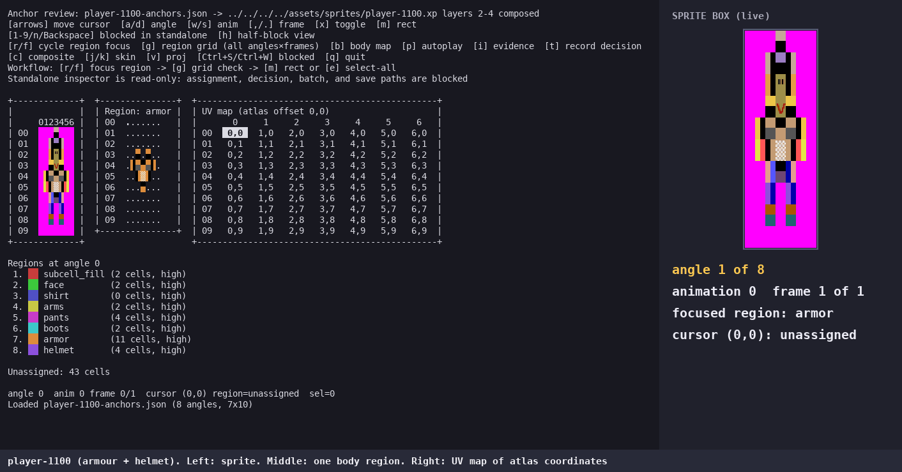
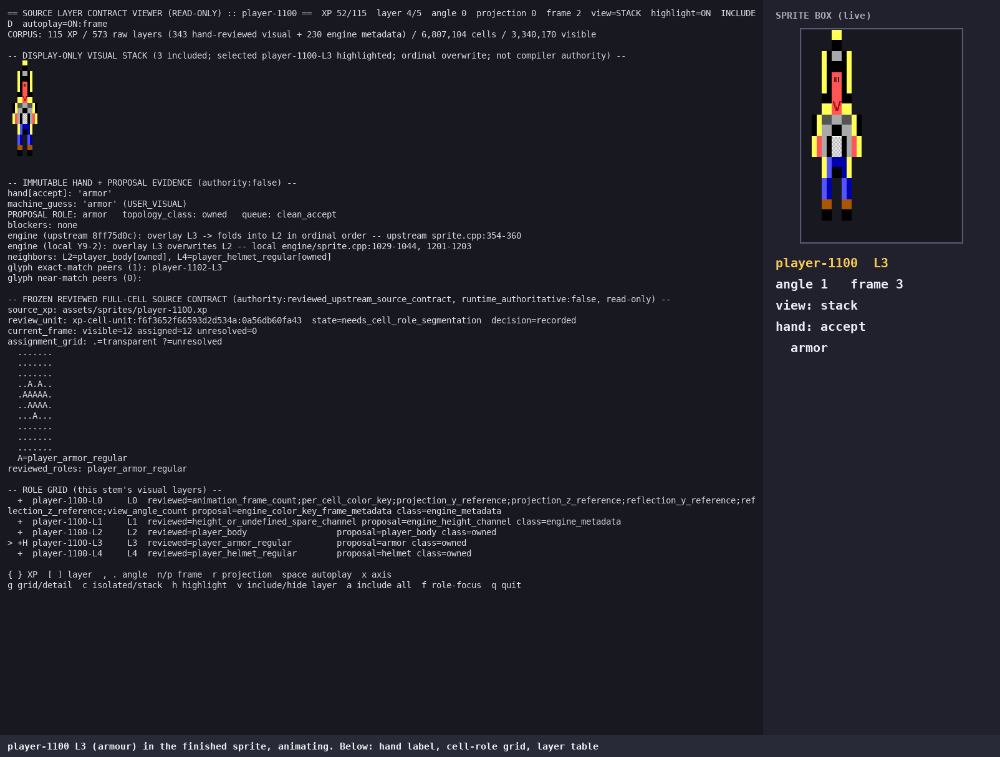

# Asciicker XP Sprite Inspector

**Inspect Asciicker character sprites with hand-labelled layer notes,
reviewed cell roles, and a body-region UV map.**

Asciicker's characters are REXPaint `.xp` files: grids of glyph + colour cells,
stacked in layers, laid out as an atlas of angles × animation frames. The game
never says what any of those cells *are*. A cell is just a glyph and two colours.
If you want to draw a new character, add a new piece of armour, or re-skin an
existing one, you have to reverse-engineer the original artists' layout by eye.

This repository does that reverse-engineering once, in the open:

1. **Hand-labelled layer notes.** Every visual layer of every packaged sprite
   (343 layers across 6 sprite families) was inspected by hand and given a
   status and a plain-language note: what is actually drawn on it, and where
   the automatic guess was wrong.
2. **Cell coordinates and semantic maps.** The full-cell ledger addresses all
   6.8 million raw cells, including transparent cells and engine metadata.
   Separate reviewed decisions describe visible-cell roles such as body,
   armour, helmet, shield and sword, preserving composite role sets. The
   normalized inspector uses a separate body-region anchor map for
   `player-1100.xp`, with regions such as face, arms, armour and helmet across
   all 8 angles. These maps guide authoring; they are inspection evidence,
   not a requirement that every new sprite fill exactly the same cells.
3. **The upstream layer contract, written down.** Which layer holds what, how
   overlays stack onto the body, and how the filename selects equipment. The
   original game relies on this but never documents it.
4. **Two terminal viewers** that show all of the above side by side with the
   actual sprite, so you can check any claim against the pixels.

### Why it's useful

- **Authoring new sprites:** draw against the UV map instead of guessing.
  You can see exactly which cells are the helmet in angle 3, frame 5, and
  keep a new helmet inside them.
- **Making equipment that layers correctly:** the layer contract tells you
  which layer an overlay must live on and what it composes over.
- **Trusting the data:** the hand notes are kept verbatim. Anything derived
  from them is marked as a proposal (`authority: false`) and never overwrites
  the human judgement it came from.

Everything here is read-only. The viewers never modify sprites, labels or
game data.

---

## Quick start

Python 3.11+, no runtime dependencies.

```sh
./run-inspector.sh    # body-part / UV-map view
./run-viewer.sh       # raw-layer view with the hand notes
```

Both accept `--once` to print a single frame without an interactive terminal.

---

## The hand-labelled layer notes

Each visual layer (L2 and up) was reviewed by hand and given three things:

| Field | Meaning |
|---|---|
| `hand_status` | How the automatic pre-guess held up: **accept** (121), **partial** (99), **reject** (122), **ambig** (1) |
| `hand_corrected_label` | What the layer actually contains |
| `hand_note` | Free-text observation (222 layers have one) |

Some real examples:

| Layer | Status | Hand note |
|---|---|---|
| `bigbee-0000-L2` | reject | "NO. BEE ONLY" (the machine guessed armour + wolf) |
| `player-1100-L2` | reject | "PLAYER NO ARMOUR NO HELMET / HAIR" |
| `wolfie-0110-L2` | partial | "wolf top part with player torso holding shield (no shield armour helm)" |
| `plydie-1002-L4` | partial | "ply die cross bow bit only" |
| `wolfie-0010-L2` | partial | "wolf body only idk if original has ears or not but it seems missing here" |

These notes are the ground truth everything else is built on. They expose what
the files really contain: riders baked into mount layers, equipment split
across layers, fragments with no clean role. A naive "L3 = armour" assumption
would get all of these wrong.

**Where to see them:**
- In the source-layer viewer, under **IMMUTABLE HAND + PROPOSAL EVIDENCE**,
  shown for whichever layer is selected.
- In the data:
  [`manual_candidate_review.json`](docs/research/ascii/semantic_maps/manual_candidate_review.json)
  (one record per layer, with the hand fields alongside the machine pre-guess).

---

## The sprite layer contract

### Sprite families

| Family | Files | What it is |
|---|---|---|
| `player` | 25 | Player on foot, plus `player-nude.xp` base |
| `attack` | 8 | Player attacking |
| `plydie` | 24 | Player death |
| `bigbee` | 25 | Player riding the big bee |
| `wolfie` | 25 | Player riding the wolf |
| `wolack` | 8 | Player attacking from the wolf |

### Filename = equipment

The four digits are **armour, helmet, shield, weapon**:

```
player-1102.xp
       │││└ weapon  0 none · 1 sword · 2 crossbow
       ││└─ shield  0/1
       │└── helmet  0/1
       └─── armour  0/1
```

The game picks the file by name (`game.cpp`). The sprite loader never reads
the name, so the digits say what the character is wearing, not which layer
holds it.

### Layers

| Layer | Holds |
|---|---|
| L0 | Colour key (engine metadata) |
| L1 | Metadata (engine metadata) |
| L2 | Base body: the layer everything composes onto |
| L3, L4, … | Overlays, folded onto L2 in order |

**Overlay roles depend on the variant, not the index.** L3 is armour in
`player-1100` but something else in a sprite without armour. Use the hand notes
or the cell map to find out what a given overlay is; don't infer it from its
number.

Across the corpus: 115 sprites, 573 raw layers (343 visual + 230 metadata),
6,807,104 cells, 3,340,170 of them visible.

---

## The two viewers

### Normalized inspector: body parts and UV coordinates

Shows the composed sprite, the selected body region, and the UV grid of atlas
coordinates. The default view is `player-1100.xp` (armour on L3, helmet on L4).

```sh
./run-inspector.sh
```

| Key | Action |
|---|---|
| arrows | move cursor |
| `a` / `d` | angle |
| `w` / `s` | animation |
| `,` / `.` | frame |
| `r` / `f` | cycle body region |
| `g` | region grid across all angles × frames |
| `b` | body-map bands |
| `q` | quit |



### Source-layer viewer: raw layers, hand notes, cell roles

Pick any of the 573 raw layers and see its raw cells, hand evidence, and
reviewed cell-role assignments. Visual layers can also be shown in a
display-only composed stack; L0 and L1 contain engine metadata.

```sh
./run-viewer.sh
./run-viewer.sh --source-key player-1100-L3 --compact   # armour layer, compact
```

| Key | Action |
|---|---|
| `{` / `}` | sprite |
| `[` / `]` | layer |
| `n` / `p` | frame |
| `.` / `,` | angle |
| `r` | projection |
| `v` | hide / show layer |
| `q` | quit |

> Heads-up: `,` and `.` step **frames** in the inspector but **angles** in this
> viewer.



---

## Data map

| Path | Contents |
|---|---|
| `assets/sprites/` | The 115 original `.xp` sprites |
| `docs/research/ascii/semantic_maps/manual_candidate_review.json` | **Hand-labelled layer notes** (343 layers) |
| `docs/research/ascii/semantic_maps/source_layer_review_decisions.jsonl` | Normalized role per layer, derived from the hand notes |
| `docs/research/ascii/semantic_maps/family_topology_contracts.json` | Per-family layer structure (base, overlays, owned vs composite) |
| `docs/research/ascii/semantic_maps/player-1100-anchors.json` | Body-region anchor map used by the normalized inspector |
| `docs/research/ascii/semantic_maps/upstream_xp_cell_contract/` | **Full-cell ledger**: raw cell addresses and values in family shards, plus separate reviewed role decisions ([format](docs/research/ascii/semantic_maps/upstream_xp_cell_contract/README.md)) |
| `docs/historical-evidence/` | Earlier review records |

Cell addressing in the full-cell ledger:

```
atlas_x = frame * frame_width  + local_x
atlas_y = angle * frame_height + local_y
```

---

## Tests and recordings

```sh
pip install -r requirements-test.txt
python3 -m unittest discover -s tests -v
```

The two walkthrough GIFs are recorded from the real viewers with
`scripts/record_tour.py`, which needs Pillow and pyte
([recording dependencies](docs/requirements-recording.txt)):

```sh
python3 -m pip install -r docs/requirements-recording.txt
python3 scripts/record_tour.py inspector docs/recordings/uv-map-inspector-tour.gif
python3 scripts/record_tour.py viewer    docs/recordings/source-layer-viewer-tour.gif
```

The storyboard (keys pressed, how long each is held, captions) is at the top of
that script. Recording uses a POSIX pseudo-terminal and an installed monospace
font such as DejaVu Sans Mono or Menlo. The short [`docs/armored-inspector.gif`](docs/armored-inspector.gif) and
[`docs/recordings/source-layer-contract-viewer.gif`](docs/recordings/source-layer-contract-viewer.gif)
recordings are pinned proof artifacts checked by the tests; they are rebuilt with
VHS 0.11.0 via `./scripts/regenerate_armored_inspector_gif.py` and
`./scripts/build-recording.sh`.

## Credits and provenance

Sprites come from the original Asciicker game. See [attribution](docs/ATTRIBUTION.md),
[source provenance](docs/provenance.md), and
[how this repo was assembled](docs/consolidation.md).
